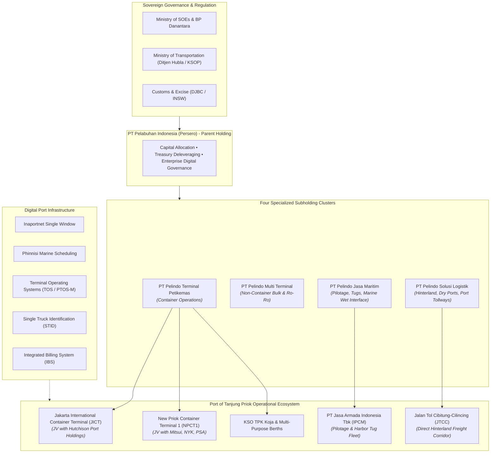
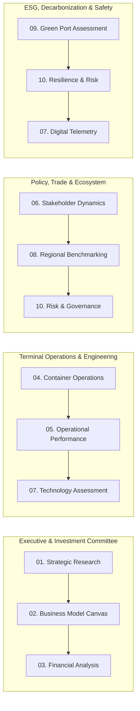

# Pelindo Strategic Studies & Tanjung Priok Maritime Intelligence

[](LICENSE)
[](#)
[](#)
[](#)

A comprehensive, institutional-grade research dossier and operational diagnostic suite evaluating the post-merger transformation of **PT Pelabuhan Indonesia (Persero) ("Pelindo")** and the operational architecture of Indonesia's premier international gateway, the **Port of Tanjung Priok**.

---

## Executive Overview

On **October 1, 2021**, Indonesia enacted one of Southeast Asia's most significant state-owned enterprise consolidations, merging Pelindo I, II, III, and IV into a unified entity: **PT Pelabuhan Indonesia (Persero)**. Prior to consolidation, fragmented regional monopolies led to divergent terminal operating systems, duplicated capital expenditures, disparate tariff schedules, and severe logistics cost disparities across the archipelago.

Post-merger, Pelindo introduced a **Holding-and-Subholding governance architecture** dividing national maritime assets into four specialized business clusters:
1. **PT Pelindo Terminal Petikemas (SPTP)**: Standardizes deep-sea and coastal container operations nationwide.
2. **PT Pelindo Multi Terminal (SPMT)**: Manages liquid bulk (CPO, petroleum), dry bulk (coal, ores, grains), Ro-Ro, and breakbulk.
3. **PT Pelindo Jasa Maritim (SPJM)**: Governs marine services including pilotage, towage, bunkering, and dredging (via operating arm PT Jasa Armada Indonesia Tbk / IPCM).
4. **PT Pelindo Solusi Logistik (SPSL)**: Manages multimodal hinterland connectivity, bonded logistics centers (PLB), inland container depots, and port tollways.

As Pelindo's primary international container gateway, the **Port of Tanjung Priok** handles over **50% of Indonesia's containerized international trade**. This repository houses ten in-depth analytical studies spanning macroeconomic strategy, terminal operations, digital platforms, regional competitiveness, ESG decarbonization, and systemic operational risk.

---

## Consolidated Performance Dashboard

Key baseline and audited trajectory metrics extracted across the research suite:

| Dimension | Baseline / 2021 | 2023 (Audited) | 2024–2026 Trajectory | Source Benchmark |
| :--- | :--- | :--- | :--- | :--- |
| **Operating Revenue** | IDR 28.80 Trillion | IDR 31.00 Trillion | IDR 35.48 Trillion (2025) | Pelindo Consolidated Financials |
| **Consolidated Net Profit** | IDR 3.20 Trillion | IDR 4.01 Trillion | IDR 1.60T (H1 2025) | Annual Audited Statements |
| **Consolidated EBITDA** | IDR 9.80 Trillion | IDR 10.35 Trillion | > IDR 11.00 Trillion | Financial Analytics |
| **Gross Outstanding Debt** | IDR 50.90 Trillion | IDR 49.87 Trillion | IDR 41.93 Trillion (Trending) | Treasury Deleveraging Program |
| **Recurring Cost Savings** | Baseline | IDR 1.30 Trillion | IDR 750 Billion / yr (Financing) | Synergies & Refinancing |
| **Container Throughput** | 16.80 Million TEUs | 17.70 Million TEUs | 18.10+ Million TEUs | SPTP National Handling |
| **Non-Container Cargo** | 145 Million Tons | 170 Million Tons | > 175 Million Tons | SPMT Liquid & Dry Bulk |
| **Vessel Traffic Volume** | 1.18 Billion GT | 1.28 Billion GT | > 1.30 Billion GT | SPJM Marine Interface |
| **Tanjung Priok Depth** | -14.0 m LWS | -14.0 m to -16.0 m LWS | -16.0 m LWS (NPCT Expansion) | Marine Fairway Survey |
| **Gross Crane Moves** | 22–24 moves/hr | 25–28 moves/hr | 30+ moves/hr target | JICT, NPCT1, KOJA Terminals |
| **National Logistics Cost** | ~23.5% of GDP | 14.29% of GDP | 8.0% OECD Target | Bappenas / Logistics Roadmaps |

---

## Ecosystem Architecture

The following diagram illustrates Pelindo's holding governance and the operational ecosystem anchoring the Port of Tanjung Priok:



---

## Repository Structure & Document Catalog

The 10 research dossiers are organized into three thematic pillars under [`docs/`](docs/):

```
.
├── README.md
├── SUMMARY.md
├── LICENSE
├── CITATION.cff
├── .gitignore
├── .gitattributes
│
└── docs/
    ├── 01-corporate-strategy/
    │   ├── pelindo-strategic-research-analysis.md
    │   ├── pelindo-business-model-analysis.md
    │   └── pelindo-financial-operational-analysis.md
    │
    ├── 02-terminal-operations/
    │   ├── tanjung-priok-container-operations.md
    │   ├── tanjung-priok-operational-performance.md
    │   └── tanjung-priok-stakeholder-ecosystem.md
    │
    └── 03-technology-benchmarking-esg/
        ├── tanjung-priok-port-technology-assessment.md
        ├── tanjung-priok-port-benchmarking.md
        ├── tanjung-priok-green-port-assessment.md
        └── tanjung-priok-risk-assessment.md
```

### Pillar 1: Corporate Strategy & Post-Merger Consolidation

| Document | Primary Scope & Focus | Target Audience |
| :--- | :--- | :--- |
| [**Strategic Research Analysis**](docs/01-corporate-strategy/pelindo-strategic-research-analysis.md) | Evaluates post-merger holding restructuring, subsidiary consolidation, national network dynamics, and strategic priorities as of Q3 2026. | C-Suite, Board of Directors, SOE Policymakers |
| [**Business Model & Value Chain**](docs/01-corporate-strategy/pelindo-business-model-analysis.md) | Deconstructs Pelindo's Business Model Canvas, subholding service delivery, value leakage points, and the K36 Immersion Canvas. | Strategy Heads, Management Consultants, Planners |
| [**Financial & Operational Linkages**](docs/01-corporate-strategy/pelindo-financial-operational-analysis.md) | Deep-dive into capital structure, debt deleveraging (IDR 50.9T &rarr; 41.9T), EBITDA margins, concession accounting, and cost-of-fund optimizations. | Equity Analysts, Chief Financial Officers, Creditors |

### Pillar 2: Terminal Operations & Maritime Logistics

| Document | Primary Scope & Focus | Target Audience |
| :--- | :--- | :--- |
| [**Container Operations & Transit Flow**](docs/02-terminal-operations/tanjung-priok-container-operations.md) | End-to-end operational lifecycle: marine navigation, quayside crane cycles, yard stacking algorithms, customs clearance, and gate drayage. Includes a 10-point field audit checklist. | Terminal Managers, Harbor Masters, Yard Planners |
| [**Operational Performance Analysis**](docs/02-terminal-operations/tanjung-priok-operational-performance.md) | Rigorous KPI evaluation: Berth Productivity (gross moves/hr), Turnaround Time (TRT), Yard Utilization, and Dwell Time root-cause analysis. | Operations Controllers, Continuous Improvement Teams |
| [**Stakeholder Ecosystem Analysis**](docs/02-terminal-operations/tanjung-priok-stakeholder-ecosystem.md) | Institutional mapping and coordination dynamics across Customs (DJBC), KSOP, shipping alliances (2M, Ocean, Premier), forwarders (ALFI), truckers (Aptrindo), and TKBM labor. | Supply Chain Directors, Trade Facilitation Officials |

### Pillar 3: Technology, Benchmarking, ESG & Risk

| Document | Primary Scope & Focus | Target Audience |
| :--- | :--- | :--- |
| [**Digital Port Infrastructure & Tech Assessment**](docs/03-technology-benchmarking-esg/tanjung-priok-port-technology-assessment.md) | Architectural analysis of Inaportnet, Phinnisi, TOS/PTOS-M, STID smart gates, IoT telematics, cyber-physical OT security, and AI opportunities. | Chief Technology Officers, Digital Transformation Leads |
| [**Port Benchmarking & Transformation Framework**](docs/03-technology-benchmarking-esg/tanjung-priok-port-benchmarking.md) | Multi-dimensional benchmark against Singapore (PSA), Malaysia (PTP, Port Klang), and Thailand (Laem Chabang) on tariff, draft, connectivity, and digital integration. | Port Economists, Strategic Competitiveness Analysts |
| [**Green Port Decarbonization & ESG Evaluation**](docs/03-technology-benchmarking-esg/tanjung-priok-green-port-assessment.md) | Evaluates Onshore Power Supply (cold ironing), hybrid/electric RTG retrofits, rooftop solar PV, MARPOL compliance, and net-zero decarbonization timelines. | ESG Officers, Environmental Auditors, Sustainability Directors |
| [**Risk, Governance & Resilience Assessment**](docs/03-technology-benchmarking-esg/tanjung-priok-risk-assessment.md) | Comprehensive hazard matrix: operational disruptions, cyber breaches, tidal flooding/subsidence risks, ISPS Code compliance, and emergency business continuity. | Chief Risk Officers, Safety Inspectors, Insurance Underwriters |

---

## Curated Reading Pathways

To assist specific stakeholders in navigating this dense dossier, four tailored reading tracks are recommended:



* **Track 1: Executive & Investment Committee**: Start with [Strategic Research](docs/01-corporate-strategy/pelindo-strategic-research-analysis.md), proceed to [Business Model Analysis](docs/01-corporate-strategy/pelindo-business-model-analysis.md), and conclude with [Financial and Operational Linkages](docs/01-corporate-strategy/pelindo-financial-operational-analysis.md).
* **Track 2: Terminal Operations & Logistics**: Focus on [Container Operations](docs/02-terminal-operations/tanjung-priok-container-operations.md), examine [Operational Performance](docs/02-terminal-operations/tanjung-priok-operational-performance.md), and inspect [Port Technology Assessment](docs/03-technology-benchmarking-esg/tanjung-priok-port-technology-assessment.md).
* **Track 3: Policy, Regulation & Trade Facilitation**: Read [Stakeholder Ecosystem](docs/02-terminal-operations/tanjung-priok-stakeholder-ecosystem.md), compare against peers in [Port Benchmarking](docs/03-technology-benchmarking-esg/tanjung-priok-port-benchmarking.md), and review [Risk & Governance](docs/03-technology-benchmarking-esg/tanjung-priok-risk-assessment.md).
* **Track 4: ESG Decarbonization & Resilience**: Study [Green Port Assessment](docs/03-technology-benchmarking-esg/tanjung-priok-green-port-assessment.md), follow up with the disaster resilience protocols in [Risk Assessment](docs/03-technology-benchmarking-esg/tanjung-priok-risk-assessment.md), and review emissions telemetry in [Technology Assessment](docs/03-technology-benchmarking-esg/tanjung-priok-port-technology-assessment.md).

---

## Citation & Academic Reference

If you cite or utilize materials from this research dossier in academic papers, industry reports, or consulting deliverables, please cite as follows:

```bibtex
@misc{pelindo_strategic_studies_2026,
  author = {Pelindo and Tanjung Priok Immersion Group},
  title = {Pelindo Strategic Studies and Tanjung Priok Maritime Intelligence Dossier},
  year = {2026},
  publisher = {GitHub},
  howpublished = {\url{https://github.com/egxl/pelindo-strategic-studies}},
  note = {Comprehensive analysis of post-merger port consolidation, container terminal operations, digital transformation, and ESG roadmap}
}
```

Or view the [CITATION.cff](CITATION.cff) file for machine-readable citation metadata.

---

## License

All analytical reports, synthesis documents, and reference structures in this repository are licensed under the **[Creative Commons Attribution 4.0 International License (CC BY 4.0)](LICENSE)**.

You are free to share, copy, redistribute, and adapt the material for any purpose, even commercially, provided appropriate credit is given and any changes are clearly indicated.
